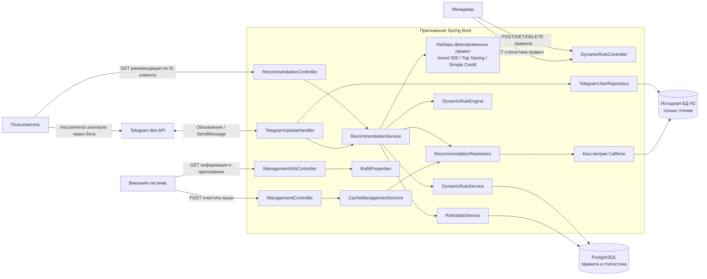
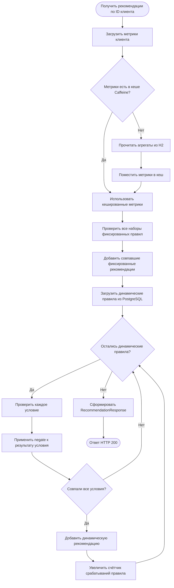

# Архитектура Star Bank Recommendation

## Обзор

Приложение построено как backend на Spring Boot. REST-контроллеры и обработчик Telegram используют общий сервис рекомендаций. Сервис загружает метрики клиента из базы H2, доступной только для чтения, через JdbcTemplate, проверяет фиксированные наборы правил и динамические правила из PostgreSQL. При совпадении динамического правила увеличивается его счётчик срабатываний.

## Диаграмма компонентов

## Диаграмма последовательности действий: формирование рекомендаций

## Компоненты

| Компонент | Ответственность |
|---|---|
| RecommendationController | REST endpoint получения рекомендаций |
| RecommendationService | Координация фиксированных и динамических правил |
| RecommendationRepository | Агрегация транзакций в H2 и кеширование метрик |
| RecommendationRuleSet | Контракт фиксированного правила |
| DynamicRuleController | CRUD динамических правил и выдача статистики |
| DynamicRuleService | Хранение и чтение динамических правил |
| DynamicRuleEngine | Проверка типов условий, аргументов, AND и negate |
| RuleStatsService | Атомарный учёт срабатываний и чтение статистики |
| CacheManagementService | Очистка всех компонентов, реализующих CacheClearable |
| ManagementInfoController | Выдача Maven artifactId и version из BuildProperties |
| TelegramUpdateHandler | Обработка /recommend username с проверкой allowlist |
| TelegramUserRepository | Поиск единственного пользователя в H2, доступной только для чтения |

## Хранилища и внешние системы

- H2 содержит исходные таблицы клиентов, продуктов и транзакций. Приложение подключается к ней в режиме «только чтение».
- PostgreSQL хранит динамические правила и статистику. Структура создаётся с помощью Liquibase.
- Telegram Bot API доставляет updates и принимает исходящие сообщения. Бот запускается только при наличии токена.
- Caffeine хранит агрегированные метрики клиента в памяти процесса; TTL составляет 10 минут, максимальный размер — 10 000 записей.

## Потоки данных

REST API и Telegram используют один RecommendationService. Telegram не вычисляет правила самостоятельно. Доступ Telegram к поиску клиентов и рекомендациям разрешён только отправителям, чьи ID перечислены в TELEGRAM_BOT_ALLOWED_USER_IDS. Пустой список означает запрет доступа для всех отправителей.
