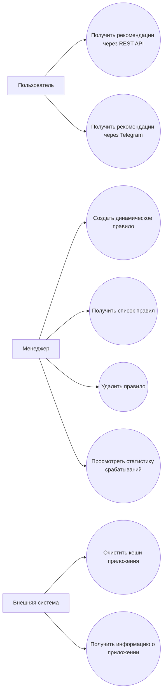

# Требования и трассировка

## Акторы

- **Пользователь (User)** — получает рекомендации для клиента через REST API или Telegram-бота. Для Telegram-сценария отправитель должен входить в allowlist приложения.
- **Менеджер (Manager)** — управляет динамическими правилами и просматривает статистику их срабатываний.
- **Внешняя система (External system)** — вызывает management API для очистки кешей и получения информации о приложении.

H2, PostgreSQL и Telegram Bot API являются внешними зависимостями приложения, а не акторами, инициирующими management-вызовы. Их взаимодействие с компонентами показано на диаграмме компонентов.

## Use Case Diagram

## User Stories

| ID | User Story | Acceptance summary | GitHub Issue | PR |
|---|---|---|---:|---:|
| US-01 | Как пользователь, я хочу получить рекомендации по UUID клиента через REST API | HTTP 200, user_id и список рекомендаций; пустой список допустим | #2 | #3 |
| US-02 | Как менеджер, я хочу создавать, читать и удалять динамические правила | PostgreSQL, Liquibase, POST/GET/DELETE /rule, валидация | #4 | #25 |
| US-03 | Как пользователь, я хочу получать рекомендации по динамическим правилам наряду с фиксированными | Четыре типа условий, AND, negate; статические правила сохранены | #8, #10 | #26, #29 |
| US-04 | Как менеджер, я хочу видеть статистику срабатываний динамических правил | Атомарный Long/BIGINT-счётчик по Long/BIGINT ID записи правила; GET /rule/stats возвращает также правила с нулевыми значениями. В JSON rule_id и count сериализуются строками | #20, #21 | #29 |
| US-05 | Как пользователь Telegram, включённый в allowlist, я хочу запросить рекомендации по username | /recommend username; только один найденный пользователь; единый сервис рекомендаций | #22 | #30 |
| US-06 | Как внешняя система, я хочу очищать кеши приложения через management API | POST /management/clear-caches очищает все зарегистрированные кеши | #23 | #30 |
| US-07 | Как внешняя система, я хочу получать сведения о приложении через management API | GET /management/info возвращает Maven artifactId и version | #24 | #30 |

## Non-functional Requirements

| ID | Требование | Проверка / Issue |
|---|---|---|
| NFR-01 | Приложение работает на Java 17 и Spring Boot | CI, Issue #1, #16 |
| NFR-02 | Исходная H2 БД используется только для чтения | Hikari read-only, параметры подключения; Issues #1, #2 |
| NFR-03 | Динамические правила и статистика хранятся отдельно от исходной H2 БД | PostgreSQL + Liquibase; Issue #4 |
| NFR-04 | Повторные запросы используют кеш метрик; кеш имеет ограничение размера и TTL | Caffeine, cache hit/miss tests; Issue #8 |
| NFR-05 | Условия динамических правил валидируются; сравнения не строятся из произвольного SQL | Белый список операторов и типизированные аргументы; Issues #4, #8 |
| NFR-06 | Секреты не хранятся в репозитории | Переменные окружения; Issue #22 |
| NFR-07 | Telegram не раскрывает рекомендации произвольным отправителям | Allowlist Telegram sender IDs; Issue #22 |
| NFR-08 | Счётчики статистики обновляются атомарно | SQL upsert/increment; Issues #20, #21 |
| NFR-09 | Ключевые сценарии покрыты автоматическими тестами и проверяются CI на Java 17 | GitHub Actions, `mvn clean verify`; Issue #16 |

## Requirements Traceability Matrix

| Requirement ID | GitHub Issue | Pull Request | Result |
|---|---:|---:|---|
| US-01 | #2 | #3 | Merged |
| US-02 | #4 | #25 | Merged |
| US-03 | #8, #10 | #26, #29 | Merged |
| US-04 | #20, #21 | #29 | Merged |
| US-05 | #22 | #30 | Merged |
| US-06 | #23 | #30 | Merged |
| US-07 | #24 | #30 | Merged |
| NFR-01 | #1, #16 | CI workflow | Java 17 CI passes; branch protection policy must be verified in repository settings |
| NFR-02 | #1, #2 | #3 | Merged |
| NFR-03 | #4 | #25 | Merged |
| NFR-04 | #8 | #26 | Merged |
| NFR-05 | #4, #8 | #25, #26, #29 | Merged |
| NFR-06, NFR-07 | #22 | #30 | Merged |
| NFR-08 | #20, #21 | #29 | Merged |
| NFR-09 | #16 | CI workflow | CI run passed; required-check branch protection remains a repository setting |

## GitHub Project workflow

Рекомендуемые статусы карточек: **To Do → In Progress → Done**. Перевод в Done выполняется после merge соответствующего PR и успешного CI. История переходов хранится в GitHub Project; Issue и PR остаются источниками технической трассировки.
